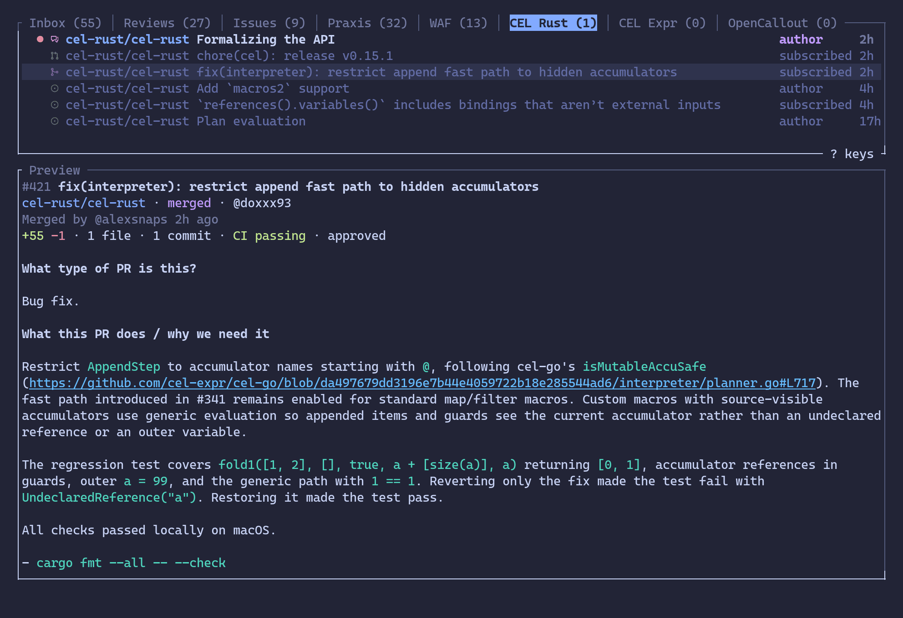
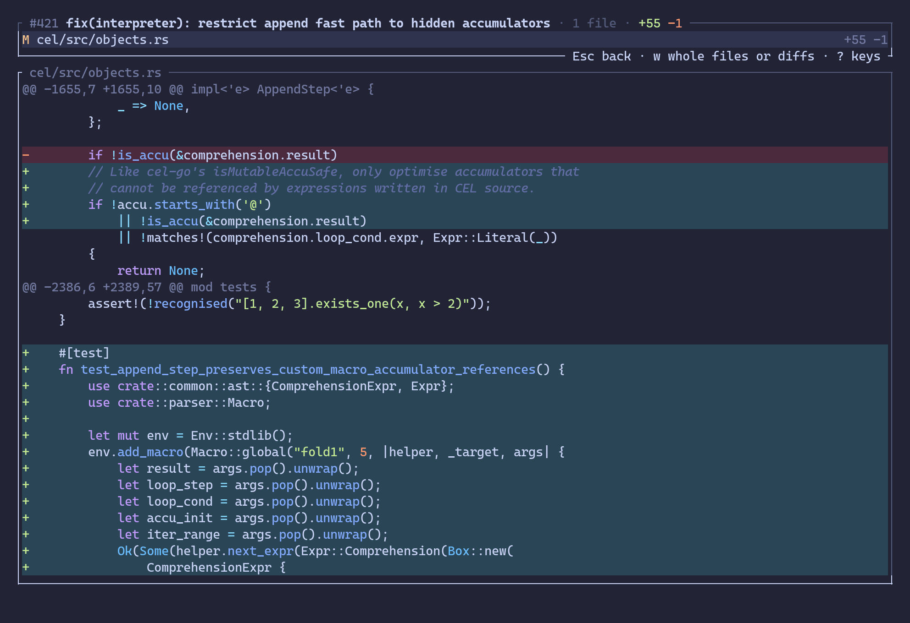
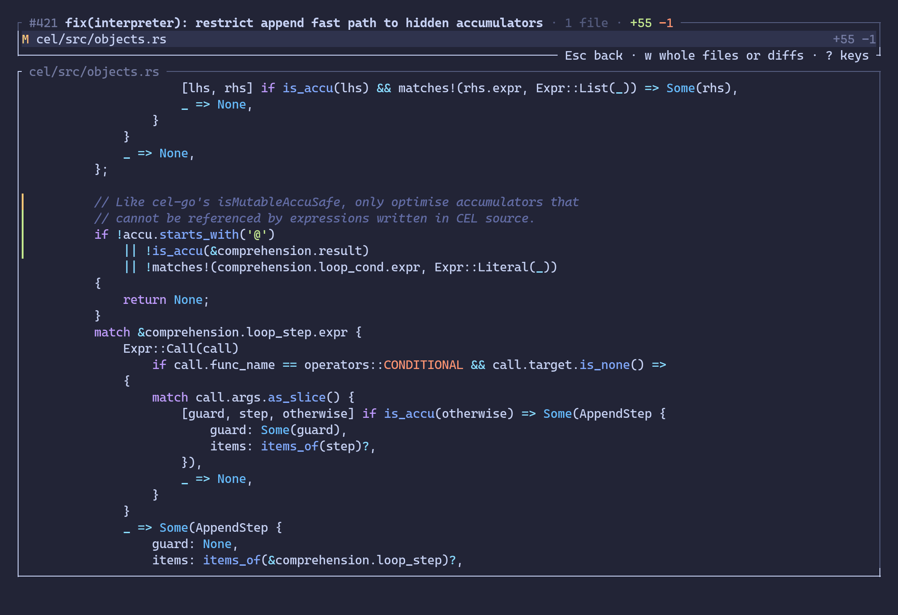
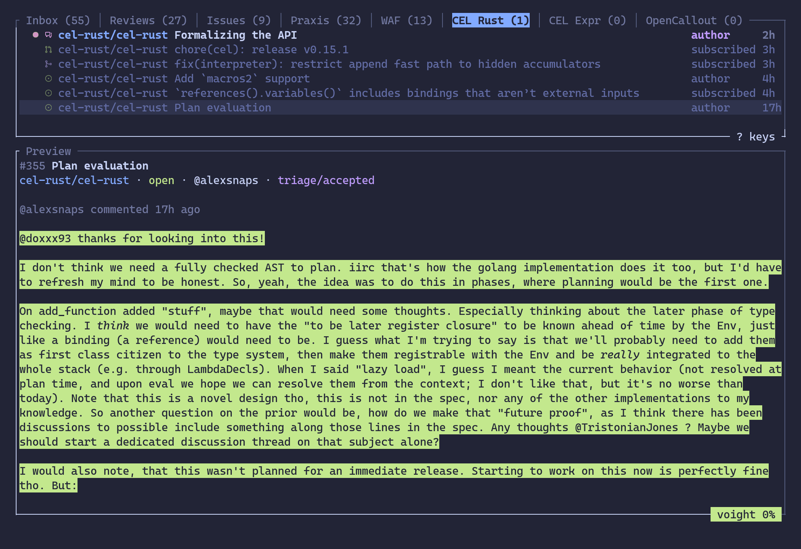

# ghd

A terminal UI to GitHub, starting with notifications. ghd keeps your notifications inbox up to date in the terminal,
organizes it into Views you define, and shows what each notification is about, down to a pull request's diffs, without
a trip to the browser.



## What it does

ghd is built on [wcgw-kit](https://github.com/wcgw/wcgw-kit), so it feels like Neovim: Vim's motions, `:` commands
with completion and history, `:map`, `:help`, highlight groups and colorschemes, windows, and which-key.

- **Views**: buffers you define, in the tabline with how many they show are unread, each showing the notifications
  its filter matches, in GitHub's inbox filter syntax (`org:cel-rust`, `reason:review-requested`, `is:pr is:unread`,
  …). The built-in Inbox View shows them all.
- **Preview**: `p` opens a window below the list showing what the notification at the cursor is about: its number,
  title, state, author and labels, then its description and its comments, the ones that mention you marked. It opens
  on the comment the notification is about, or the description you're asked to review; `]]` and `[[` step through
  the comments once you're in it (`<C-w>j`). Pull requests add their diffstat, commits, CI and reviews; discussions
  their category and answer. Markdown is rendered, its code highlighted, its links followed with `<CR>` or `gx`.
  Looking never marks anything read.
- **Files**: `gf` lists a pull request's changed files and shows the one at the cursor below, as its diff,
  highlighted.

  

  `<leader>w` shows the files whole instead, Markdown rendered, with a gutter marking the lines added (green),
  changed (yellow) or removed (red); `/` searches the file shown, as in any buffer. `<Esc>`, `gf` or `<C-o>` go back.

  

- **voight**: optionally, [voight](https://github.com/wcgw/voight) estimates how much of the Preview's text an LLM
  wrote, shown in the statusline for the comment the Preview's cursor is in; `<leader>h` shows its Heatmap, each
  stretch of prose it scored (about 100 to 400 words) shaded from green (0%) to red (100%). An estimate, never
  evidence of authorship.

  

- **Triage**: mark notifications read (`I`) or Done (`x`), one at a time or a selection of them, made by hand or
  with a filter (`:select is:closed` selects what's merged or closed); narrow the View to a filter (`:filter`), show
  only what's unread (`u`), and look back at what's Done (`D`).

The screenshots are from before wcgw-kit: the borders are gone, and what they said is in the statusline.

## Install

From a clone, with a recent stable Rust (ghd is in the 2024 edition):

```sh
cargo install --locked --path .
```

ghd builds against a checkout of [wcgw-kit](https://github.com/wcgw/wcgw-kit) beside its own (`../wcgw-kit`) until
wcgw-kit is published. That builds voight in, running on the CPU. Add `--features cuda` to run it on an NVIDIA GPU (this needs the CUDA
toolkit's `nvcc`), `--features metal` on a Mac's GPU (on Apple silicon, voight builds with Metal anyway, unless with
wgpu), or `--features wgpu` on any other GPU, Intel or AMD say, through Vulkan on Linux. wgpu is experimental:
candle's wgpu backend is unreleased, so voight builds on [a fork](https://github.com/huggingface/candle/pull/3379). Or
leave voight out with `--no-default-features`.

The first time it starts with voight, ghd downloads voight's model, about 1.7 GB, into the Hugging Face cache. Set
`voight = "off"` to start without it.

## Signing in

ghd uses the token in `GH_TOKEN` or `GITHUB_TOKEN` (`GH_ENTERPRISE_TOKEN` or `GITHUB_ENTERPRISE_TOKEN` for GitHub
Enterprise Server), or else asks the [GitHub CLI](https://cli.github.com) for one: with `gh` signed in, there's nothing
to do.

## Configuration

`~/.config/ghd/config.toml` (`$XDG_CONFIG_HOME/ghd/config.toml` when that's set) says what ghd shows. Everything in
it is optional:

```toml
host = "github.example.com"  # github.com by default
user = "octocat"             # gh's active account on the host by default
voight = "off"               # "cpu" by default; "cuda", "metal" or "wgpu" in a ghd built for them

[[view]]
name = "Reviews"
filter = "reason:review-requested is:unread"

[[view]]
name = "CEL Rust"
filter = "org:cel-rust"
```

Views follow the Inbox View in the tabline, in this order.

**Filters** are GitHub's [inbox filters](https://docs.github.com/en/subscriptions-and-notifications/reference/inbox-filters)
(`repo:`, `org:`, `reason:`, `is:`), which ghd evaluates itself, with a few additions: `-` negates a qualifier,
`repo:` takes `*` wildcards, `is:pr` and `is:issue` are told apart, and `is:` takes a pull request's or issue's state
(`is:open`, `is:draft`, `is:merged`, `is:closed`, `is:completed`, `is:not-planned`). A repeated qualifier matches
either, different ones must all match. The details are in [the decision record](docs/adr/0001-filter-syntax.md).

**How it looks, and its keys**, are wcgw-kit's: `~/.config/wcgw/init.vim`, shared by every wcgw app, then
`~/.config/ghd/init.vim`, hold `:colorscheme`, `:set` (`icons=auto|nerd|plain`, `mouse=`, …), `:hi` and the `:map`
family. `tokyonight-moon` is the default colorscheme, `default` the terminal's own colors. ghd's highlight groups
(`GhdRepository`, `GhdStateMerged`, `VoightHeatLlm`, …) link to standard ones; `:hi` changes them. The `theme` and
`icons` settings of `config.toml`, and theme files, are read no more: [`scripts/theme-to-vim.py`](scripts/theme-to-vim.py)
turns a theme file into `:hi` lines.

## Keys

Vim's: `j` `k` `gg` `G` `<C-d>` `<C-u>`, `/` `?` `n` `N` to search the buffer, `]]` `[[` from notification to
notification, or comment to comment, `<C-w>` and `q` for windows, `:` for commands, `:help` (`<F1>`) for all of
them. ghd adds these, each running a command `:map` can rebind:

| Keys | Command | What they do |
|---|---|---|
| `<CR>` `gX` | `:open` `:browse` | open in the browser, which marks read; `<CR>` follows a link too |
| `gx` | `:browse link` | open the link under the cursor |
| `gy` | `:yanklink` | yank the link `gX` opens |
| `I` | `:read` | mark read |
| `x` | `:done` | mark Done; in the Done list, back to the Inbox |
| `D` | `:donelist` | show the Done list, or the Inbox again |
| `u` | `:unreadonly` | show unread only, or all again |
| `s` `A` | `:toggle` `:toggle!` | select or not, and move down; all shown, or none |
| | `:select` `:unselect` *filter* | select, or unselect, what the [filter](#configuration) matches in the View; all shown, with no filter |
| `<leader>f` | `:filter` *filter* | narrow whichever View is on screen to what the filter matches; all again, with no filter |
| `<Esc>` | `:clear` | clear the selection, or else the filter; leave the Files screen |
| `p` | `:preview` | show or hide the Preview |
| `gf` `<leader>w` | `:files` `:whole` | a pull request's files; files whole, or their diffs |
| `<leader>h` | `:voight heatmap` | voight's Heatmap; `:voight on` and `off` start and stop it |
| `gt` `gT` `<leader>1`–`9` | `:bnext` `:bprevious` `:buffer` | show the next, previous, or nth View |
| `<C-l>` | `:edit!` | fetch the Inbox now, and the Preview or the files shown |
| `:q` `:qa` | | close the window; quit |

`I`, `x`, `<CR>` and `gX` act on the selection when there is one. `<leader>` is `<Space>`. On the command line, `Tab`
completes commands and a filter's qualifiers or, after one, its values that would select some of the notifications
shown; `↑` and `↓` go through the commands entered before.

The mouse is wcgw-kit's: the wheel scrolls the window under it, a click moves the cursor there, a double click opens
what it lands on. Most terminals select text with Shift held; `:set mouse=` leaves the mouse to the terminal.

Keys that changed from before wcgw-kit, as Vim has `e`, `f`, `w`, `g`, `?`, digits and `Space`: `e` is `x`, `f` is
`gf`, `w` is `<leader>w`, `o` and `Enter` are `<CR>` or `gX`, `Space` is `s`, `Tab` and `1`–`9` are `gt` and
`<leader>1`–`9`, `r` is `<C-l>`, `H` is `<leader>h`, `?` is `:help`, `J` and `K` are `<C-w>j` and the Preview's own
motions. `:nnoremap e :done<CR>` in `init.vim` brings one back.

## License

[Apache-2.0](LICENSE).
