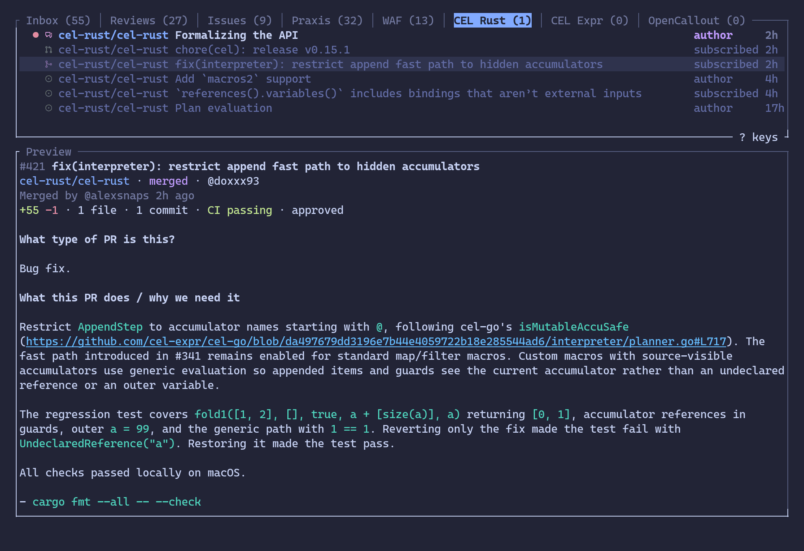
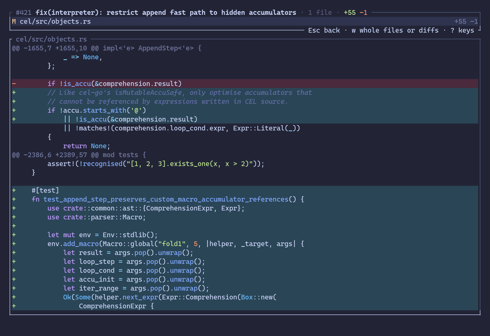
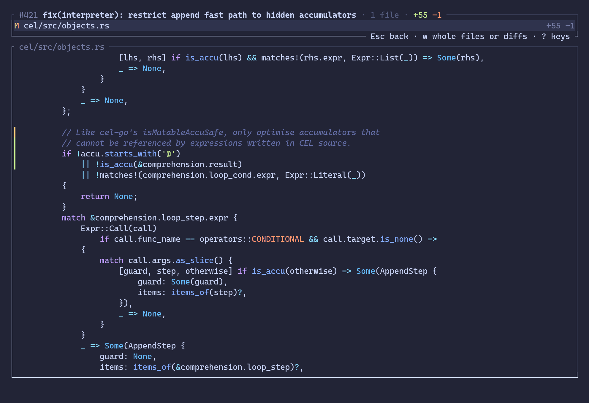
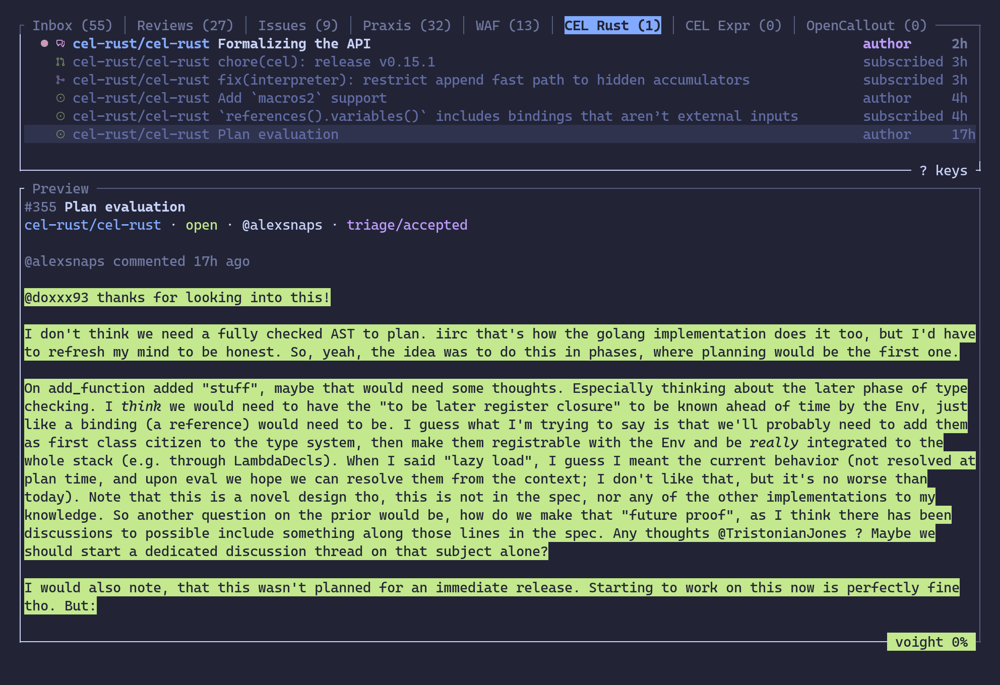

# ghd

A terminal UI to GitHub, starting with notifications. ghd keeps your notifications inbox up to date in the terminal,
organizes it into tabs you define, and shows what each notification is about, down to a pull request's diffs, without
a trip to the browser.



## What it does

- **Views**: tabs you define, each showing the notifications its filter matches, in GitHub's inbox filter syntax
  (`org:cel-rust`, `reason:review-requested`, `is:pr is:unread`, …). The built-in Inbox View shows them all.
- **Preview**: `p` shows what the notification at the cursor is about: its number, title, state, author and labels,
  then the comment it's about, the latest by the time of the notification, or the description of what you're asked
  to review or assigned. `J` and `K` scroll it, then step through the other comments, the ones that mention you
  marked. Pull requests add their diffstat, commits, CI and reviews; discussions their category and answer. Markdown
  is rendered and its code highlighted. Looking never marks anything read.
- **Files**: `f` lists a pull request's changed files and shows each one's diff, highlighted.

  

  `w` shows the files whole instead, Markdown rendered, with a gutter marking the lines added (green), changed
  (yellow) or removed (red).

  

  `/` searches the file shown as you type, ignoring case: every match is highlighted, and the first one from where
  the file is scrolled to comes to the middle of the pane; `n` and `N` go on to the next match or back to the previous.

- **voight**: optionally, [voight](https://github.com/wcgw/voight) estimates how much of a Preview's text an LLM
  wrote, shown at the bottom of the pane; `H` shows its Heatmap, each stretch of prose it scored (about 100 to 400
  words) shaded from green (0%) to red (100%). An estimate, never evidence of authorship.

  

- **Triage**: mark notifications read (`I`) or Done (`e`), one at a time or a selection of them, made by hand or
  with a filter (`:select is:closed` selects what's merged or closed); search the View on screen (`/`), show only
  what's unread (`u`), and look back at what's Done (`D`).

## Install

From a clone, with a recent stable Rust (ghd is in the 2024 edition):

```sh
cargo install --locked --path .
```

That builds voight in, running on the CPU. Add `--features cuda` to run it on an NVIDIA GPU (this needs the CUDA
toolkit's `nvcc`), `--features metal` on a Mac's GPU (on Apple silicon, voight builds with Metal anyway, unless with
wgpu), or `--features wgpu` on any other GPU, Intel or AMD say, through Vulkan on Linux. wgpu is experimental:
candle's wgpu backend is unreleased, so voight builds on [a fork](https://github.com/huggingface/candle/pull/3379). Or
leave voight out with `--no-default-features`.

The first time it starts with voight, ghd downloads voight's model, about 1.7 GB, into the Hugging Face cache. Set
`voight = "off"` to start without it.

## Signing in

ghd uses the token in `GH_TOKEN` or `GITHUB_TOKEN` (`GH_ENTERPRISE_TOKEN` or `GITHUB_ENTERPRISE_TOKEN` for GitHub
Enterprise Server), or else asks the [GitHub CLI](https://cli.github.com) for one: with `gh` signed in, there's nothing
to do.

## Configuration

`~/.config/ghd/config.toml` (`$XDG_CONFIG_HOME/ghd/config.toml` when that's set). Everything in it is optional:

```toml
host = "github.example.com"  # github.com by default
user = "octocat"             # gh's active account on the host by default
theme = "terminal"           # tokyonight-moon by default
icons = true                 # Nerd Font icons for kinds of notification; false by default
voight = "off"               # "cpu" by default; "cuda", "metal" or "wgpu" in a ghd built for them

[[view]]
name = "Reviews"
filter = "reason:review-requested is:unread"

[[view]]
name = "CEL Rust"
filter = "org:cel-rust"
```

Views follow the Inbox View in the tabs, in this order.

**Filters** are GitHub's [inbox filters](https://docs.github.com/en/subscriptions-and-notifications/reference/inbox-filters)
(`repo:`, `org:`, `reason:`, `is:`), which ghd evaluates itself, with a few additions: `-` negates a qualifier,
`repo:` takes `*` wildcards, `is:pr` and `is:issue` are told apart, and `is:` takes a pull request's or issue's state
(`is:open`, `is:draft`, `is:merged`, `is:closed`, `is:completed`, `is:not-planned`). A repeated qualifier matches
either, different ones must all match. The details are in [the decision record](docs/adr/0001-filter-syntax.md).

**Themes**: `tokyonight-moon` and `terminal` (the terminal's own colors) are built in. A theme of your own goes in
`themes/<name>.toml` next to `config.toml`; [`themes/`](themes) has the built-in ones to start from.

## Keys

| Keys | What they do |
|---|---|
| `j` `k` `↓` `↑` `g` `G` | move to the next, previous, first or last notification |
| `Ctrl-D` `Ctrl-U` | move half a page down or up |
| `Space` `A` | select or not, and move down; all shown, or none |
| `:select` `:unselect` *filter* | select, or unselect, the notifications shown that the [filter](#configuration) matches; all shown, with no filter |
| `Tab` `Shift-Tab` | show the next or previous View |
| `1`–`9` | show a View by its place in the tabs |
| `o` `Enter` | open in the browser, which marks read |
| `I` | mark read |
| `e` | mark Done; in the Done list, back to the Inbox |
| `D` | show the Done list, or the Inbox again |
| `u` | show unread only, or all again |
| `p` `H` | show or hide the Preview; voight's Heatmap |
| `J` `K` | scroll the Preview, and step through its comments |
| `f` `w` | a pull request's files; files whole, or their diffs |
| `/` `n` `N` | search the View on screen, or the file on the Files screen; the next or previous match |
| `Esc` | clear the selection, or else the search |
| `r` | fetch the Inbox now |
| `?` | show these keys |
| `:q` `Ctrl-C` | quit |

In the search prompt and on the command line, `Tab` and `Shift-Tab` complete the name being typed, a search's field,
a command or a filter's qualifier, and go through the ways to complete it when pressed again.

The mouse wheel scrolls the Preview, or the file on the Files screen, while it shows, and otherwise moves through the
list. As ghd takes the mouse's clicks too, most terminals select text with Shift held.

## License

[Apache-2.0](LICENSE).
